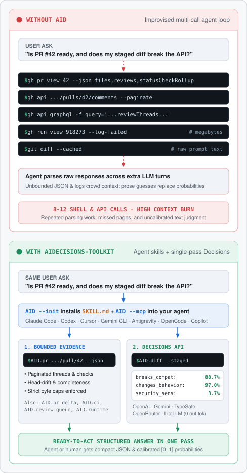

# AIDecisions-Toolkit

<picture>
  <source media="(prefers-color-scheme: dark)" srcset="docs/assets/aid-overview-dark.svg">
  <source media="(prefers-color-scheme: light)" srcset="docs/assets/aid-overview-light.svg">
  
</picture>

`AIDecisions-Toolkit` (`AID`) gives coding agents compiled Go tools and
single-pass Decisions API checks (across OpenAI, Google Gemini, TypeSafe Jev,
OpenRouter, and LiteLLM) that return bounded JSON and calibrated probabilities
in one call. Every command runs directly in a terminal, and `AID --init`
installs matching `SKILL.md` skills and registers the `aid` stdio MCP server
(`AID --mcp`) in Codex, Claude Code, Cursor, Gemini CLI, Antigravity, OpenCode,
and GitHub Copilot so your agents already know when and how to invoke each tool
for you.

| Tool | What it gives the agent |
| --- | --- |
| `AID.diff` | Evaluates a diff against named yes/no probability checks via native Decisions APIs |
| `AID.pr` | Collects bounded, read-only GitHub pull-request files, checks, reviews, and threads with freshness tracking |
| `AID.pr-delta` | Reports what changed on a pull request since a reviewer's last review (head relation, hunk delta, threads, CI, and stack state) |
| `AID.review-queue` | Lists open pull requests awaiting review, tagged `new` or `re_review` with each `pr-delta` verdict |
| `AID.ci` | Collects attempt-pinned GitHub Actions job failures, annotations, redacted log excerpts, and artifact metadata |
| `AID.runtime` | Inspects Linux and Android AArch64 ELF files in-process and returns a 4 KiB static-fact packet |
| `AID.discover` | Prepares redacted session-history evidence so the current agent can identify new tool candidates |

## Install a release

Download the native ZIP matching your OS and architecture from
[GitHub Releases](https://github.com/wallentx/AIDecisions-Toolkit/releases).
Extract it, keep all executables together in one directory on `PATH`, and run
`AID --init` to install both agent skills and MCP client configuration.
Archives include checksums and build provenance.

Termux users build from source using the commands below. `AID.runtime` inspects
files on Linux and Android hosts, and builds on other platforms return an
explicit unavailable result.

## Build on this device

Run `./install.sh` to build and install the complete suite to `~/.local/bin`,
then run `AID --init` to configure skills and MCP across your local coding
agents. The build script requires Go and prints a `PATH` setup command when
needed. To choose another directory, run
`INSTALL_DIR=/absolute/path/to/bin ./install.sh`.

Run these commands from the `AIDecisions-Toolkit` directory to build into
`./dist`:

```sh
go run ./cmd/aid-build
./dist/AID --list
./dist/AID.diff --example --dry-run
```

Use a currently supported Go toolchain (language minimum: Go 1.26). Each device
builds native binaries locally. On Windows, use `dist\AID.exe` and
`dist\AID.diff.exe`. On Termux, use the native Go/C toolchain and its default
CGO setting. Running the built executables requires no Go toolchain. Discovery
uses Reflect for native history and optional Python for a `.py` helper, while
importing normalized scan JSON needs neither dependency.

Keep `AID` and its tool executables together in the same directory. Add that
directory to `PATH`, or build directly into your binary directory with
`go run ./cmd/aid-build --out DIRECTORY`.

## Suite commands

| Command | Result |
| --- | --- |
| `AID -i`, `AID --init` | Open the interactive picker to install or update agent skills and MCP configuration |
| `AID --mcp` | Serve cached tool collectors and `pr_delta` to an MCP client over stdio ([docs/mcp.md](docs/mcp.md)) |
| `AID -l`, `AID --list` | List tools and descriptions |
| `AID -v`, `AID --version` | Show suite and individual executable versions |
| `AID -u`, `AID --update` | Fetch release source, build locally, and replace installed binaries |
| `AID -b`, `AID --build` | Print the new-tool intake template for an agent or user |
| `AID -h`, `AID --help` | Show usage |

`--init` follows Reflect's provider-selection and review/apply pattern and
writes nothing until you confirm the plan. `--build` prints the design intake,
whereas `go run ./cmd/aid-build` compiles the source tree. `--list` and
`--version` accept `--json`.

## Use AID.diff

```sh
AID.diff --example --dry-run
AID.diff --provider openai --model gpt-6-luna --staged
AID.diff --provider typesafe --model jev-latest --staged
AID.diff --provider gemini --model gemini-decision-1 --staged
AID.diff --provider openrouter --model ~typesafe/jev-latest --staged
AID.diff --provider litellm --model jev --endpoint http://127.0.0.1:4000 --staged
git diff --no-ext-diff --no-textconv | AID.diff
AID.diff --diff change.diff --context 'Public REST API'
```

`AID.diff` calls native Decisions APIs directly in Go (`openai` by default,
`typesafe` for TypeSafe Jev System One, `gemini` for Google Gemini Decisions,
and `openrouter` for OpenRouter's multi-model Decisions API), with optional
`litellm` gateway support and zero Python, Node.js, or proxy dependencies
required for direct providers. Set `OPENAI_API_KEY`, `TYPESAFE_API_KEY`,
`GEMINI_API_KEY`, `OPENROUTER_API_KEY`, or `LITELLM_API_KEY`, or configure
isolated key-file paths under `providers.<provider>.api_key_file` in
`~/.config/AID/config.yml` (existing `global.api_key_file` configurations
continue to work for `openai` without leaking to other providers). Dry runs
inspect the resolved provider, endpoint, model, and translated wire payload
locally without credentials or network calls. Results default to JSON for
agents/pipes and a table in a terminal. See
[Decisions providers and configuration](docs/usage.md).

## Collect pull-request and review-queue evidence

```sh
AID.pr --repo OWNER/REPO --pr 42 --json
AID.pr-delta --repo OWNER/REPO --pr 42 --text
AID.review-queue --text
```

All three GitHub PR tools reuse your installed `gh` authentication and perform
read-only API requests without posting comments or approving changes. Inspect
incomplete sources and freshness drift before relying on a snapshot. See
[pull-request evidence](docs/pr.md), [review queue](docs/review-queue.md), and
[MCP server](docs/mcp.md).

## Collect CI failure evidence

```sh
AID.ci --repo OWNER/REPO --run 123 --attempt 2 --json
AID.ci https://github.com/OWNER/REPO/actions/runs/123 --json
AID.ci --repo OWNER/REPO --run 123 --attempt 2 --dry-run
```

The tool reuses `gh` and the shared GitHub transport to pin one run attempt,
collect jobs, annotations, and bounded log excerpts, and report run-wide
artifact metadata separately. Missing logs and truncated evidence remain
visible. See [CI evidence and limitations](docs/ci.md).

## Inspect static runtime facts

```sh
AID.runtime --json /absolute/path/to/binary
AID.runtime --host-manifest host.json --json /absolute/path/to/binary
```

The tool reads AArch64 ELF files in-process without launching external
inspectors. It returns declarations, hashes, explicitly allowlisted host/path
observations, and unknowns in a packet capped at 4 KiB. See
[static runtime facts and manifest format](docs/runtime.md).

## Prepare discovery evidence

```sh
AID.discover --all-projects --days 365 --dry-run
AID.discover --input scan.json --all-projects --days 365
```

Discovery requires no API key and returns bounded JSON plus snapshot references
so the current agent can assess recurring workflows and obtain independent
review. See [discovery usage and privacy](docs/discover.md).

## Documentation

Read [Configuration and usage](docs/usage.md),
[MCP server](docs/mcp.md),
[Review queue](docs/review-queue.md),
[Pull-request evidence](docs/pr.md),
[CI evidence](docs/ci.md),
[Static runtime facts](docs/runtime.md),
[Discovery usage](docs/discover.md),
[Adding tools and releases](docs/development.md),
[Intake template](internal/intake/template.md), and
[v0.1.0 release notes](docs/releases/v0.1.0.md) for detailed contracts.
